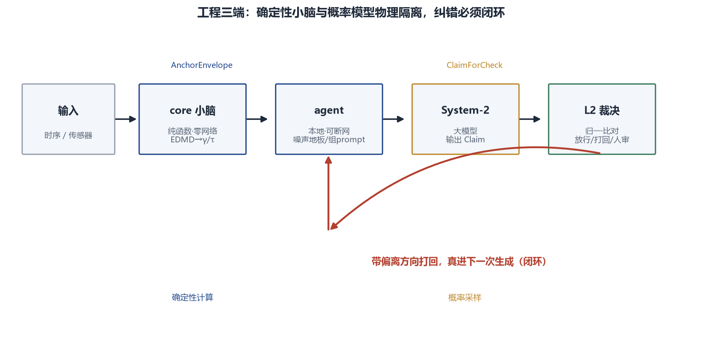
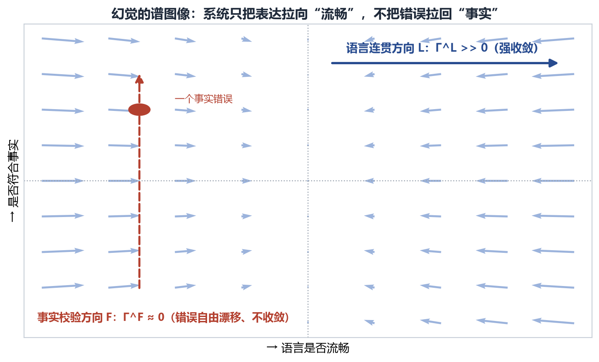
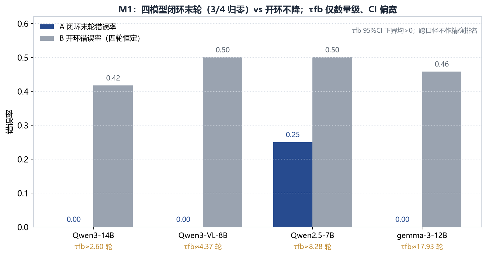
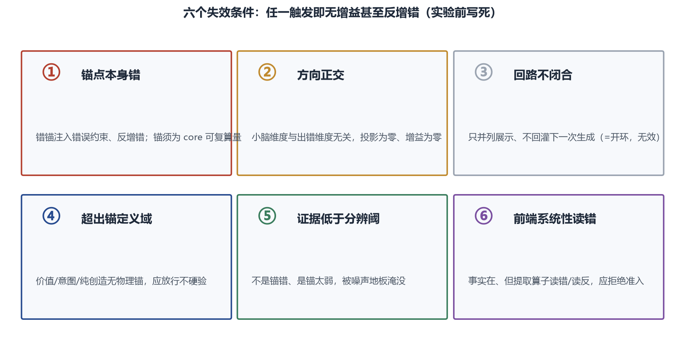

# 给大模型装一个"物理小脑" · IGT Physical Cerebellum

> 用非厄米谱动力学算出的**确定性弛豫时间谱（τ 谱）**作为可复算的证据锚，
> 让大模型在"事实校验方向"上的错误，从**自由漂移（不收敛）**变为**指数收敛**。

[](LICENSE)
[](LICENSE-DOCS.md)



---

## 这是什么

大语言模型（Large Language Model, LLM）的幻觉，在谱图像上表现为一种**各向异性**：
在"语言连贯方向"上耗散很强（表达被拉向流畅），在"事实校验方向"上耗散近似为零
（错误不被拉回事实，自由漂移）。

本仓库给出一个可复现的对照实验：在概率模型（System-2，负责不确定方向的探索）之外，
加一个**确定性"物理小脑"（System-1）**——它从观测时序计算非厄米演化算子
**L = H − iΓ**（Γ>0）的本征谱，得到耗散率 γ 与弛豫时间 τ = 1/γ，并用**中心化 z**
（相对零分布、而非相对 0）判定方向是否显著；闭环时把这些**统计判据**（不泄露目标方向）
反馈给模型，错误即沿反馈收敛。

这是一个**条件性机制**，不是普适定理，也不宣称"已消灭幻觉"。



---

## 核心结果（证据档）

**M1 实验（2026-09-09，24 题冻结题集，A=闭环 / B=开环，每题独立重复 3 次，
bootstrap 1000 次；本地 CPU、llama.cpp、量化模型）：**

| 模型 | A 臂末轮错误率 | B 臂首轮错误率（四轮不降） | τfb（轮）[95% CI] |
|---|---|---|---|
| Qwen3-14B | **0.000** | 0.417 | 2.60 [1.52, 7.83] |
| Qwen3-VL-8B | **0.000** | 0.500 | 4.37 [1.87, 29.96] |
| Qwen2.5-7B-Instruct | 0.250 | 0.500 | 8.28 [3.86, 23.17] |
| gemma-3-12B | **0.000** | 0.458 | 17.93 [6.81, 53.98] |

- **B 臂（同样的锚、但不做闭环反馈）错误率四轮不下降，反升率为 0**——锚本身不改变输出，
  起作用的是**闭环**；
- 四个模型 τfb 的置信区间下界均 > 0（确为收敛、非噪声）；
- 早期 M0（2026-09-04）：A 臂错误率 1.00→0.50、B 臂恒 1.00、τfb≈5.8 轮（R²=0.99）。
  **M0 原始过程文件未完整保留，数字以论文附录 B 为准，不伪造轨迹。**



**失效条件同样被明确列出**（六条，避免"脆弱假绿"）：锚点错、方向正交投影为零、
回路不闭合、超出锚的定义域、证据低于分辨阈、前端系统性读错/读反。



---

## 仓库结构

```
igt-physical-cerebellum/
├── igt_core/                 确定性小脑（Rust）：非厄米谱、γ、τ、证据锚（524 测试通过）
├── bench/                    24 题冻结题集：CSV + 证据锚 EV + 谱图 + 波形生成器
├── experiment/
│   ├── run_closed_loop.py    自包含闭环编排（A 闭环 / B 开环 / D 题面，可断点续跑）
│   ├── harness/              模型臂 r3-claim（调用 llama.cpp）
│   ├── analysis/             标定查表、统计、口径转换脚本
│   └── results/              M1 四模型轨迹 + 代码口径历史归档
├── figures/                  5 张配图 + 生成脚本
├── paper/                    案例论文 v1.3（Markdown）+ 图文版（HTML）
├── CALIBRATION.md            符号口径的唯一权威（务必先读）
├── DATA_SOURCES.md           数据来源、获取方式与许可
├── LICENSE                   代码许可：Business Source License 1.1
└── LICENSE-DOCS.md           文档/数据/配图许可：CC BY 4.0
```

---

## 快速开始与复现

**1. 编译并测试确定性小脑：**

```bash
cd igt_core
cargo test          # 524 个测试应全部通过
```

**2. 编译模型臂 harness：**

```bash
cd ../experiment/harness
cargo build --release
```

**3. 自行安装推理后端并下载模型权重**（不随仓库分发，许可为各自条款）：

- llama.cpp：https://github.com/ggerganov/llama.cpp （MIT）
- 模型：Qwen3-14B / Qwen3-VL-8B / Qwen2.5-7B-Instruct / gemma-3-12B，
  从其官方发布渠道下载对应量化（如 Q4_K_M）GGUF。

**4. 跑闭环（先 `--selftest`、再 `--dry` 核对命令，最后正式跑）：**

```bash
cd ../..
python experiment/run_closed_loop.py \
  --bench bench \
  --claim-bin experiment/harness/target/release/r3-claim.exe \
  --llama-cli /path/to/llama-cli \
  --model /path/to/model.gguf \
  --model-name Qwen2.5-7B-Instruct \
  --arms A,B,D
```

可用 `--ids ZCL001,ZBL001` 只跑指定题、`--fresh` 忽略断点重跑。
**符号口径（γ 的正负、present ⟺ z<−1 等）务必先读 [CALIBRATION.md](CALIBRATION.md)。**

---

## 论文与数据

- 完整案例论文：[`paper/IGT物理小脑_案例论文_v1.3.md`](paper/IGT物理小脑_案例论文_v1.3.md)
  （图文版 [`paper/物理小脑_图文论文_v1.2.html`](paper/物理小脑_图文论文_v1.2.html)）；
- 每一类数据的来源、生成参数、获取方式、许可与缺口：[DATA_SOURCES.md](DATA_SOURCES.md)。

---

## 许可证

- **代码**（`.rs`、`.py`）：[Business Source License 1.1](LICENSE)，
  允许内部生产、学术研究、个人使用及在其上构建应用，仅限制 Change Date 前把小脑本身作为
  竞争性托管/嵌入服务提供；**Change Date 2028-04-13 起自动转为 Apache License 2.0**。
- **论文、数据记录、配图、说明文档**：[CC BY 4.0](LICENSE-DOCS.md)
  （可自由共享与改编、含商业用途，只需署名）。

---

## 作者

**郑达（Damon）**，元衍拓扑学（Intrinsic Generative Topology, IGT）独立研究者。

- 邮箱：258642612@qq.com　·　微信：z25864
- 知乎：https://www.zhihu.com/people/300lao-si-ji

## 适用域与边界

全部结论仅在论文声明的精确条件下成立：**系统失稳窄任务 × 中心化 z 证据锚 × 本地开源模型**。
它证明的是"正定的闭环反馈使错误指数收敛"这一**收敛性**结果；"最优熵耗散路径"等更强主张
仍属待证假说，不在本仓库声称之列。
